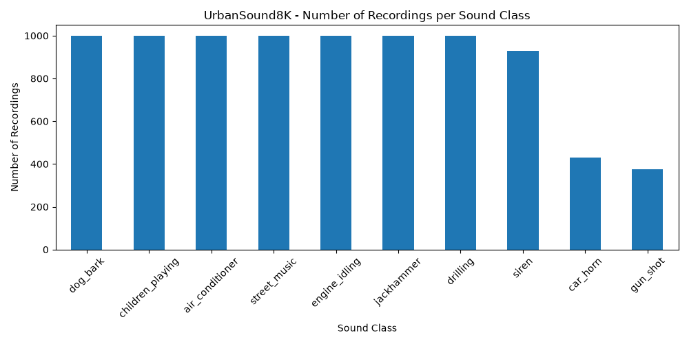

# UrbanSound8K Environmental Sound Classification

Environmental sound classification using spectrograms and convolutional neural networks.

## Dataset

[UrbanSound8K](https://urbansounddataset.weebly.com/urbansound8k.html) contains 8,732 recordings from ten sound classes, organized into ten predefined folds.



## Setup

Use Python 3.12 and run commands from the repository root.

```bash
python -m venv .venv
source .venv/bin/activate
pip install -r requirements.txt
python -m scripts.download_dataset
python -m scripts.prepare_features
```

`prepare_features` computes the Log-Mel spectrogram of every clip once (about 0.7 GB in `data/features/`, ignored by Git), so analysis and training do not decode audio every epoch. `pip install` gives the CPU build of PyTorch; for an NVIDIA GPU, install PyTorch first with the command from [pytorch.org](https://pytorch.org/get-started/locally/).

On Windows PowerShell, activate with `.venv\Scripts\Activate.ps1`.

The download script saves the dataset location to `.dataset_path` (ignored by Git), and the scripts find it automatically. If the dataset is already in the kagglehub cache, it is found without downloading again. To use a copy stored elsewhere, set `URBANSOUND8K_PATH` (bash: `export URBANSOUND8K_PATH=/path/to/dataset`, PowerShell: `$env:URBANSOUND8K_PATH = "C:\path\to\dataset"`).

Both the Kaggle layout (CSV and fold directories at the root) and the original dataset layout (metadata/ and audio/) are supported.

## Audio representation

Recordings are resampled to 22,050 Hz, converted to mono, padded or cropped to four seconds and peak-normalized. STFT uses 2,048 FFT points and a 512-sample hop. Log-Mel features use 128 bands and are scaled to [0, 1]. Silent recordings map to zero-valued features.


## Model inputs

```python
from src.data_loader import load_split

X_train, y_train = load_split("train")
X_val, y_val = load_split("validation")
```

For PyTorch, use the cached features instead:

```python
from src.datasets import make_dataloaders

loaders = make_dataloaders(batch_size=32)
x, y = next(iter(loaders["train"]))  # x: (32, 1, 128, 173), y: (32,)
```

Each `load_split` sample has shape (128, 173, 1), with integer labels 0–9. For channels-first models, transpose batches with X.transpose(0, 3, 1, 2). The iterator iter_samples also supports loading individual examples without retaining every spectrogram in memory.

Training uses folds 1–8, validation fold 9 and final testing fold 10. One source recording (fsID 180937) occurs in both training and validation folds. The split loader excludes its 79 training clips, retaining the original validation and test folds. The resulting partitions contain 7,000 training, 816 validation and 837 test clips; all 8,732 clips remain available for dataset analysis. Use load_split for model experiments, rather than the unfiltered fold loader. Use the same split for each model and reserve test results for final evaluation. This is a fixed holdout protocol, rather than ten-fold cross-validation.

## Custom CNN

`notebooks/spectrogram_analysis.ipynb` compares STFT and Log-Mel spectrograms and selects **Log-Mel**: it has 8 times fewer values per clip (128 × 173 instead of 1,025 × 173) and keeps fine frequency resolution at low frequencies, where much of the energy of urban sounds lies. The network takes the full 4 s spectrogram, **(1, 128, 173)**: cropping to 128 frames would drop about 24% of the real audio frames, and resizing would distort sound durations.

`src/model.py` defines `UrbanSoundCNN`:

| Stage | Layers | Output shape |
|---|---|---|
| Input | Log-Mel spectrogram | 1 × 128 × 173 |
| Block 1 | 2 × (Conv 3×3, BatchNorm, ReLU), MaxPool 2×2, Dropout2d 0.1 | 32 × 64 × 86 |
| Block 2 | same, 64 filters | 64 × 32 × 43 |
| Block 3 | same, 128 filters | 128 × 16 × 21 |
| Block 4 | same, 256 filters | 256 × 8 × 10 |
| Head | Global average pooling, Dropout 0.3, FC 256→128, ReLU, Dropout 0.3, FC 128→10 | 10 logits |

The default model has 1,206,826 parameters (4.6 MB) and needs about 1.1 G multiply-accumulates per spectrogram. It returns logits for `nn.CrossEntropyLoss`. The number of blocks, filters, convolutions per block, dropout rates and hidden units are constructor arguments for the hyperparameter experiments. Global average pooling keeps the classifier independent of the input width, so random time crops can be used for augmentation without changing the model.

```bash
python -m scripts.model_summary --real-batch   # prints the layer table and saves reports/custom_cnn_summary.txt
```

## Repository layout

| Directory | Contents |
|---|---|
| notebooks/ | Dataset exploration and spectrogram analysis |
| src/ | Audio preprocessing, spectrograms, dataset loading, feature cache and CNN model |
| scripts/ | Download, inspection, validation, feature preparation and model summary |
| reports/ | Model summary |
| metadata/ | Metadata and audio properties |
| figures/ | Dataset and spectrogram visualizations |
| tests/ | Preprocessing, loader, feature cache, analysis and model tests |

## Reproduce the analysis

```bash
python -m pytest -q
python -m scripts.explore_dataset
python -m scripts.analyze_audio
python -m scripts.inspect_audio
python -m scripts.validate_dataset
jupyter nbconvert --to notebook --execute --inplace notebooks/dataset_exploration.ipynb
python -m scripts.prepare_features
python -m scripts.model_summary --real-batch
jupyter nbconvert --to notebook --execute --inplace notebooks/spectrogram_analysis.ipynb
```

Raw audio is excluded from version control.
