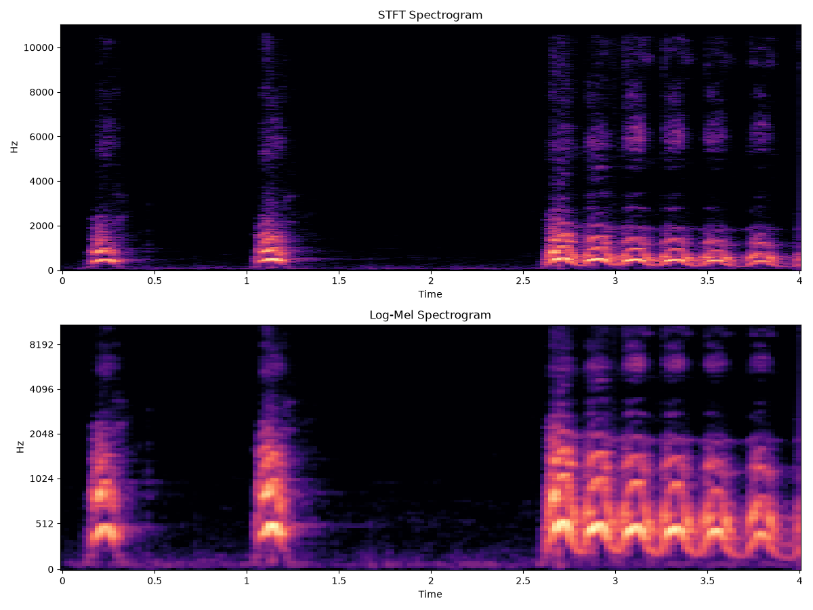

# UrbanSound8K Environmental Sound Classification

Environmental sound classification using spectrograms and convolutional neural networks.

## Dataset

[UrbanSound8K](https://urbansounddataset.weebly.com/urbansound8k.html) contains 8,732 recordings from ten sound classes, organized into ten predefined folds.


## Setup

Use Python 3.12 and run commands from the repository root.

```bash
python -m venv .venv
source .venv/bin/activate
pip install -r requirements.txt
python -m scripts.download_dataset
```

On Windows PowerShell, activate with `.venv\Scripts\Activate.ps1`.

The download script saves the dataset location to `.dataset_path` (ignored by Git), and the scripts find it automatically. If the dataset is already in the kagglehub cache, it is found without downloading again. To use a copy stored elsewhere, set `URBANSOUND8K_PATH` (bash: `export URBANSOUND8K_PATH=/path/to/dataset`, PowerShell: `$env:URBANSOUND8K_PATH = "C:\path\to\dataset"`).

Both the Kaggle layout (CSV and fold directories at the root) and the original dataset layout (metadata/ and audio/) are supported.

## Audio representation

Recordings are resampled to 22,050 Hz, converted to mono, padded or cropped to four seconds and peak-normalized. STFT uses 2,048 FFT points and a 512-sample hop. Log-Mel features use 128 bands and are scaled to [0, 1]. Silent recordings map to zero-valued features.



## Model inputs

```python
from src.data_loader import load_split

X_train, y_train = load_split("train")
X_val, y_val = load_split("validation")
```

Each sample has shape (128, 173, 1), with integer labels 0–9. For channels-first models, transpose batches with X.transpose(0, 3, 1, 2). The iterator iter_samples also supports loading individual examples without retaining every spectrogram in memory.

Training uses folds 1–8, validation fold 9 and final testing fold 10. One source recording (fsID 180937) occurs in both training and validation folds. The split loader excludes its 79 training clips, retaining the original validation and test folds. The resulting partitions contain 7,000 training, 816 validation and 837 test clips; all 8,732 clips remain available for dataset analysis. Use load_split for model experiments, rather than the unfiltered fold loader. Use the same split for each model and reserve test results for final evaluation. This is a fixed holdout protocol, rather than ten-fold cross-validation.

## Repository layout

| Directory | Contents |
|---|---|
| notebooks/ | Dataset exploration |
| src/ | Audio preprocessing, spectrograms and dataset loading |
| scripts/ | Download, inspection and validation |
| metadata/ | Metadata and audio properties |
| figures/ | Dataset and spectrogram visualizations |
| tests/ | Preprocessing and loader tests |

## Reproduce the analysis

```bash
python -m pytest -q
python -m scripts.explore_dataset
python -m scripts.analyze_audio
python -m scripts.inspect_audio
python -m scripts.validate_dataset
jupyter nbconvert --to notebook --execute --inplace notebooks/dataset_exploration.ipynb
```

Raw audio is excluded from version control.
