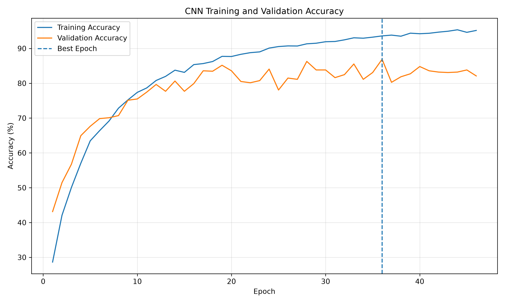
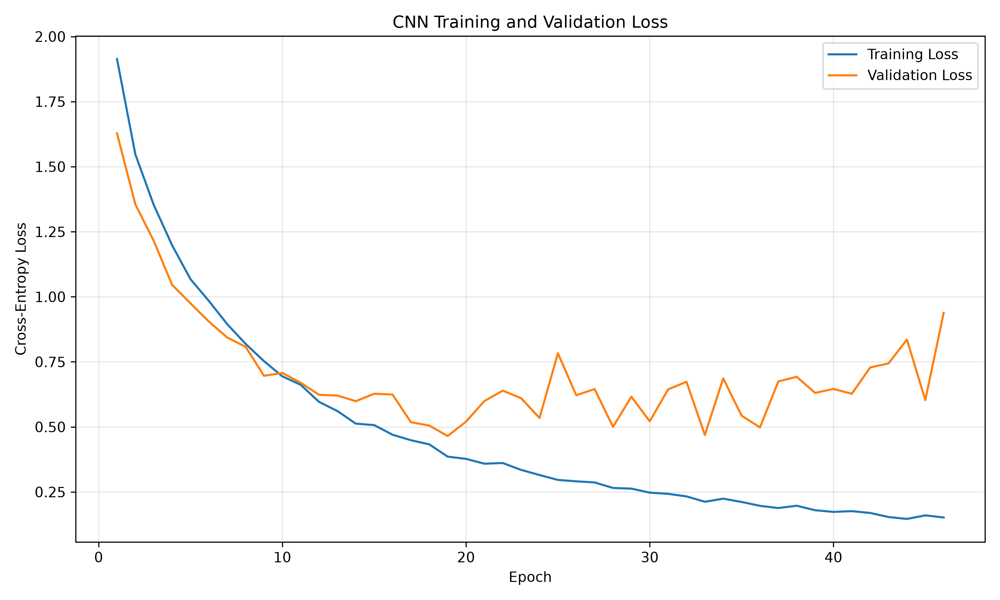
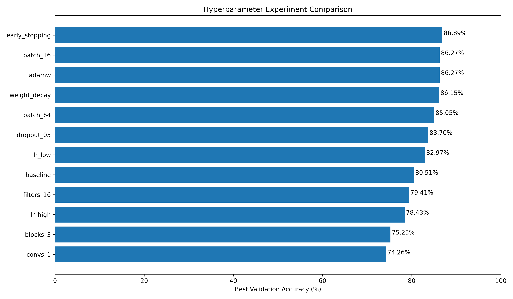

# Member 3 – CNN Training & Hyperparameter Optimization

## 1. Objective

The objective of this part of the project is to train the custom CNN on the UrbanSound8K dataset and improve its performance through hyperparameter optimization and regularization.

## 2. Dataset Preparation

The prepared Log-Mel spectrograms were used as input to the CNN.

- Training samples: 7,000
- Validation samples: 816
- Test samples: 837
- Input shape: 1 × 128 × 173
- Number of output classes: 10

The test dataset was reserved for final evaluation.

## 3. Training Implementation

The training pipeline was implemented using PyTorch.

- Loss function: CrossEntropyLoss
- Optimizers: Adam and AdamW
- Training device: Apple MPS
- Random seed: 42

Training and validation loops were implemented to monitor loss and accuracy after every epoch. The best-performing model was saved according to validation accuracy.

## 4. Hyperparameter Experiments

| Experiment | Best Validation Accuracy |
|---|---:|
| Original baseline | 80.51% |
| Learning rate 0.0001 | 82.97% |
| Learning rate 0.003 | 78.43% |
| Batch size 16 | 86.27% |
| Batch size 64 | 85.05% |
| Three convolutional blocks | 75.25% |
| Base filters 16 | 79.41% |
| One convolution per block | 74.26% |
| Dropout 0.5 | 83.70% |
| AdamW | 86.27% |
| Adam with weight decay | 86.15% |
| Extended training with early stopping | 86.89% |

## 5. Overfitting and Underfitting

The baseline model achieved 96.00% training accuracy and 80.51% validation accuracy at its selected checkpoint. This difference suggests overfitting.

Reducing the learning rate and batch size improved validation performance and reduced the observed training-validation accuracy gap.

Experiments with fewer convolutional layers and filters achieved lower training and validation accuracy, suggesting insufficient learning capacity or slower convergence within the training budget.

## 6. Regularization

The following regularization techniques were investigated:

- Dropout
- Weight decay
- AdamW
- Early stopping

Early stopping was implemented with a patience of 10 epochs. The best model was saved at epoch 36, and training stopped at epoch 46.

## 7. Best Model Configuration

| Parameter | Value |
|---|---|
| Learning rate | 0.0001 |
| Batch size | 16 |
| Convolutional blocks | 4 |
| Convolutional layers | 8 |
| Base filters | 32 |
| Classifier dropout | 0.3 |
| Convolutional dropout | 0.1 |
| Optimizer | Adam |
| Weight decay | 0 |
| Early stopping patience | 10 |
| Best epoch | 36 |
| Trainable parameters | 1,206,826 |

## 8. Final Results

- Baseline validation accuracy: 80.51%
- Best validation accuracy: 86.89%
- Improvement: 6.38 percentage points
- Training accuracy at best epoch: 93.60%
- Training loss at best epoch: 0.1967
- Validation loss at best epoch: 0.4980
- Total training time of selected experiment: 30.92 minutes

### Accuracy Curves



### Loss Curves



### Hyperparameter Comparison



## 9. Reproducibility

To reproduce the selected training configuration after preparing the dataset:

```bash
python -m scripts.train --epochs 50 --batch-size 16 --lr 0.0001 --optimizer adam --weight-decay 0 --patience 10 --run-name early_stopping
```

To regenerate the performance graphs:

```bash
python -m scripts.plot_results
```

Selected model checkpoint: `checkpoints/best_cnn.pth`

## 10. Limitations

The experiments were conducted using a single random seed. Hyperparameter selection was based on validation accuracy. Final test performance has not yet been measured.

The early-stopping experiment also used a larger epoch budget, so its improvement cannot be attributed exclusively to early stopping.

## 11. Conclusion

Hyperparameter optimization improved the custom CNN's validation accuracy from 80.51% to 86.89%. The original four-block architecture, combined with a lower learning rate, smaller batch size and early stopping, produced the best observed validation performance.

The trained custom CNN is ready for the team's final comparison with transfer learning models.