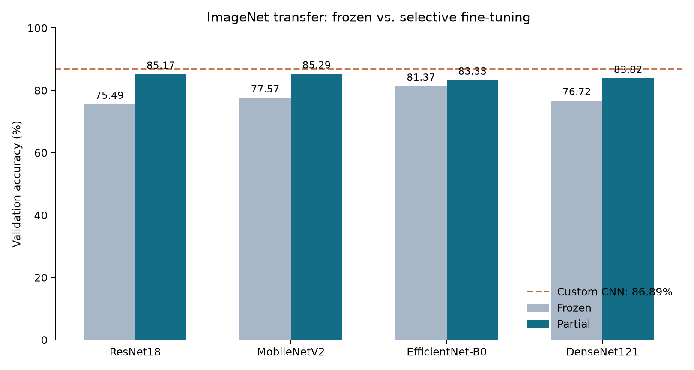
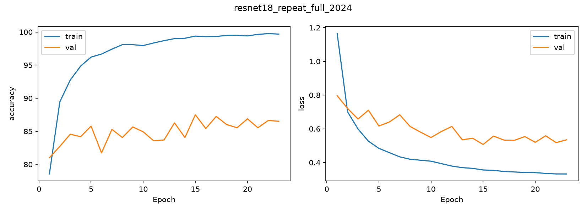
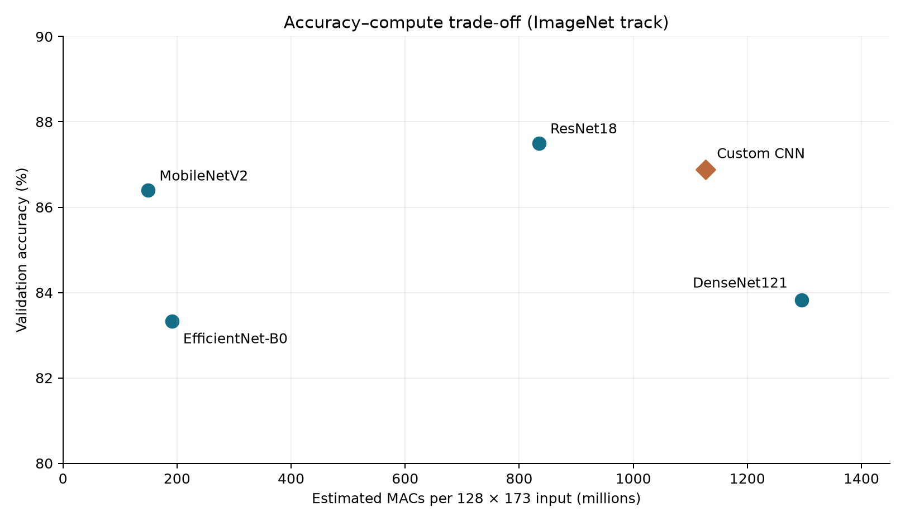
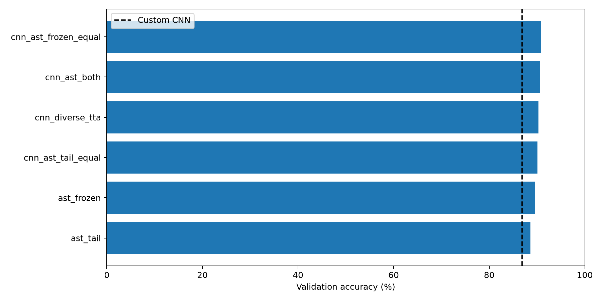
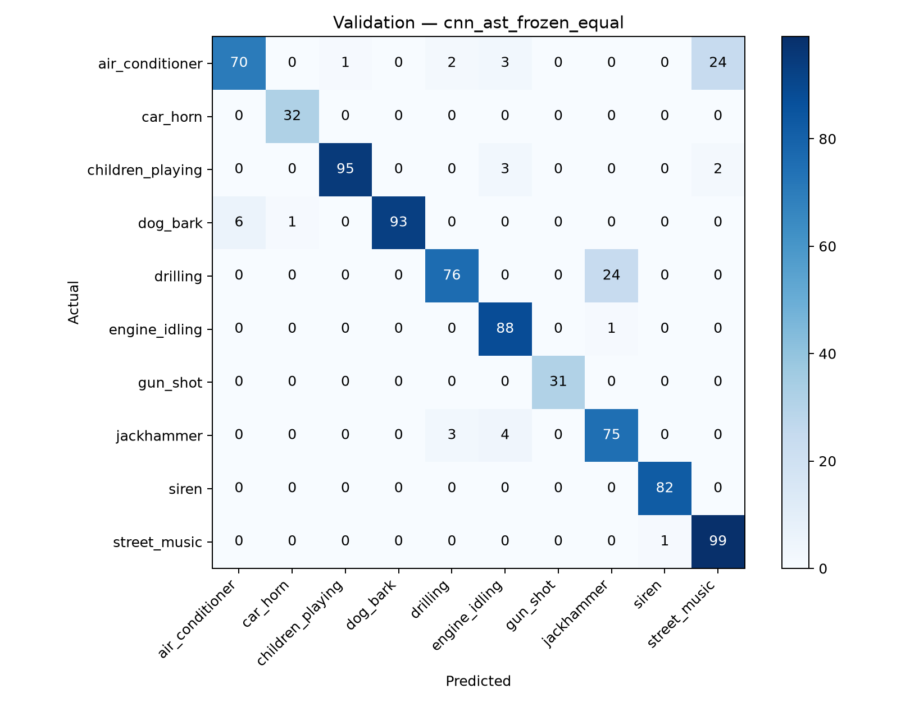

# Member 4 — Transfer Learning & Model Implementation

**UrbanSound8K · Mahij Khantigiri Gosai · Validation-only study**

## Executive summary

We compared ImageNet-pretrained CNNs using exactly the team's existing log-Mel representation and source-disjoint fixed holdout. Frozen feature extraction, selective fine-tuning and full fine-tuning were evaluated. An optional, separately reported AudioSet-pretrained extension investigated whether sound-specific prior knowledge improves performance.

| Decision | Model | Validation accuracy | Macro F1 |
|---|---|---:|---:|
| Required CNN handoff — best observed | ResNet18, full fine-tuning, seed 2024 | **87.50%** | 88.68% |
| Efficiency alternative | MobileNetV2, full fine-tuning + Mixup, seed 42 | 86.40% | 87.87% |
| Optional audio-pretrained single CNN | EfficientAT MN20, partial fine-tuning, seed 123 | **90.20%** | 91.02% |
| Optional exploratory ensemble | EfficientAT + frozen AST | **90.81%** | 91.92% |
| Member 3 reference (read-only replay) | Custom CNN, seed 42 | 86.89% | 87.89% |

The ImageNet winner is only 0.61 percentage points above the custom CNN, and its three-seed mean is slightly lower; there is no evidence of a robust ImageNet-only improvement. Audio-specific pretraining is more promising, but uses additional data and a different frontend. The optional extension achieved 90.81% validation accuracy; the final test fold remains reserved.

## 1. Scope and integration

This contribution covers Steps 4.1 (pretrained CNN research, complexity, adaptation), 4.2 (frozen and fine-tuned training, hyperparameters, validation curves and checkpoints), and 4.3 (comparison, parameter counts, timing and handoff). It reuses the team's preprocessing, dataset loader, class ordering, device selection and Member 3 benchmark. Existing teammate source files and checkpoint are unchanged.

The official 8,732-clip UrbanSound8K metadata is split into training folds 1–8, validation fold 9 and reserved test fold 10. The existing loader removes 79 training clips from shared source recording fsID 180937. The audit verified 7,000 / 816 / 837 clips and disjoint source IDs (1,048 / 125 / 124). The test-fold metadata is used only to confirm split integrity; no Member 4 model is trained, tuned or evaluated on fold 10. The team's shared feature cache contains all folds, but training and validation loaders select only the permitted partitions. This is not official ten-fold cross-validation.

## 2. Step 4.1 — architectures and input adaptation

| Architecture | Why included | Backbone adaptation |
|---|---|---|
| ResNet18 | Residual learning; compact standard reference | Replace final linear layer; partially unfreeze layer4 |
| MobileNetV2 | Depthwise separable convolutions and inverted residual blocks | Replace classifier; partially unfreeze final 3 feature modules |
| EfficientNet-B0 | Compound-scaled efficient CNN | Replace classifier; partially unfreeze final 3 feature modules |
| DenseNet121 | Dense feature reuse | Replace classifier; partially unfreeze denseblock4 and norm5 |

All four use torchvision default ImageNet weights, a new dropout + linear head with 10 logits, and the same original 1 × 128 × 173 log-Mel input. Single-channel input is replicated across RGB channels and normalized with ImageNet mean/std; no time/frequency resizing or cropping. Global pooling yields a fixed-length representation. Trainable parameter counts are recorded after setting each stage.

## 3. Step 4.2 — training protocol

- Frozen: train only the new head; backbone is held in evaluation mode, including batch normalization.
- Partial: train head and selected final backbone blocks; frozen batch-normalization layers remain in evaluation mode.
- Full: fine-tune the entire backbone using separate learning rates for backbone and head.
- AdamW, cross-entropy, cosine annealing, validation-accuracy selection (lower validation loss breaks ties), early stopping with patience 8, fixed seeds 42/123/2024.
- Initial head LR 0.001; partial head LR 0.0003 and backbone LR 0.0001. Advanced recipes vary learning rate, time/frequency masking, Mixup and label smoothing.
- Baseline epochs: up to 12 frozen, 25 partial, 30 full. Exact per-run hyperparameters, histories and checkpoint lineage are preserved in [member4/](member4/) and [member4_audio/](member4_audio/).
- Train augmentation applies only during training. Mixup training accuracy compares against unmixed first labels and is diagnostic, not directly comparable with ordinary training accuracy.

### Initial architecture comparison (seed 42)

| Architecture | Frozen val. accuracy | Partial val. accuracy | Gain (pp) | Frozen trainable | Partial trainable |
|---|---:|---:|---:|---:|---:|
| ResNet18 | 75.49% | 85.17% | +9.68 | 5,130 | 8,398,858 |
| MobileNetV2 | 77.57% | 85.29% | +7.72 | 12,810 | 1,218,890 |
| EfficientNet-B0 | 81.37% | 83.33% | +1.96 | 12,810 | 3,168,550 |
| DenseNet121 | 76.72% | 83.82% | +7.11 | 10,250 | 2,170,378 |

The initial ranking changes after fine-tuning. EfficientNet-B0 is best when frozen, but MobileNetV2 and ResNet18 benefit more from selective adaptation. The two strongest partial models were chosen for deeper optimization. ResNet18 with SpecAugment and label smoothing (0.05) was the strongest seed-42 ImageNet run (87.01%).

## 4. Step 4.3 — accuracy, complexity and training cost

All accuracy and F1 values are validation measurements. Training time includes the checkpoint lineage for the selected run, excluding cache preparation and pretrained weight downloads; it is not total search cost. MAC estimates are THOP results for a single spectrogram, not measured FLOPs. Batch-1 latency is measured on Apple MPS after 10 warmup iterations and averaged over 50 synchronized forward passes; excludes audio decoding and preprocessing. Latency fluctuates with device load and is not portable across hardware.

| Model | Val. accuracy | Macro F1 | Params (M) | MACs (M) | MPS ms | Lineage min |
|---|---:|---:|---:|---:|---:|---:|
| Custom CNN (Member 3) | 86.89% | 87.89% | 1.21 | 1,127 | 1.36 | 30.92* |
| ResNet18 (seed 2024) | 87.50% | 88.68% | 11.18 | 835 | 2.99 | 8.40 |
| MobileNetV2 (Mixup) | 86.40% | 87.87% | 2.24 | 150 | 5.51 | 5.60 |
| EfficientNet-B0 (partial) | 83.33% | 84.10% | 4.02 | 191 | 6.85 | 3.81 |
| DenseNet121 (partial) | 83.82% | 85.20% | 6.96 | 1,295 | 12.40 | 6.01 |
| EfficientAT MN20 (optional) | 90.20% | 91.02% | 16.59 | 866 | 6.25 | 6.91 |
| EfficientAT MN10 (optional) | 89.34% | 90.36% | 4.21 | 236 | 5.42 | 4.74 |

*Member 3 training duration comes from its existing report, not a new training run. Its checkpoint accuracy and F1 were independently replayed on the validation fold.

ResNet18 has a modest accuracy advantage but many more parameters than the custom CNN. MobileNetV2 uses approximately 82% fewer estimated MACs than ResNet18, with a 1.10 pp accuracy trade-off. On this Mac, its measured latency is not lower. It is the smaller checkpoint (8.75 MiB vs 42.72 MiB), making it an appropriate efficiency alternative, not a guaranteed speed winner.

### Reproducibility

| Recipe | Seed 42 | Seed 123 | Seed 2024 | Mean ± sample SD |
|---|---:|---:|---:|---:|
| ResNet18 regularized full | 87.01% | 85.54% | 87.50% | 86.68% ± 1.02 pp |
| EfficientAT MN20 higher-LR full (optional) | 89.71% | 89.71% | 89.34% | 89.58% ± 0.21 pp |
| EfficientAT MN20 partial (optional) | 89.71% | 90.20% | 89.22% | 89.71% ± 0.49 pp |

Repeated seeds characterize training variation on the same validation fold, not independent test performance. The best observed checkpoint is a validation-selected run, which may overestimate generalization.

## 5. Optional extension — AudioSet and ensembles

This extension is intentionally separate from the required ImageNet-only comparison.

- EfficientAT MN10/MN20/MN40: official AudioSet-pretrained weights; 32 kHz, 128 × 400 features and native log-mel normalization. Frozen, selective and full tuning.
- PANNs CNN14: official AudioSet weights; frozen 2048-dimensional embeddings, six train-only logistic/SVM classifier fits.
- AST: AudioSet-pretrained transformer, 16 kHz, 400-frame input with cropped temporal positional embeddings; 18 frozen classifier fits and one final-block fine-tuning run. This is outside the CNN requirement.
- Eight-checkpoint EfficientAT ensemble with ±80 ms inference-time shifts on validation; uniform probabilities. Fixed equal CNN/AST probability blend.
- AudioSet overlap with UrbanSound8K cannot be conclusively ruled out. The EfficientAT frontend is a torch reimplementation of the upstream eval parameters (Torchaudio 2.15 was unavailable); exact numeric equivalence was not established. AST uses a shortened input and float16 cached prefix activations; the upstream NumPy feature extractor emits a mel-filter warning, but finite forward/backward outputs were verified.

| Optional result | Validation accuracy | Macro F1 |
|---|---:|---:|
| MN20 best single, partial | 90.20% | 91.02% |
| MN10 partial | 89.34% | 90.36% |
| MN40 frozen | 89.09% | 90.27% |
| PANNs frozen + RBF | 88.97% | 90.13% |
| AST frozen + RBF decision rule | 89.71% | 91.03% |
| AST final-block fine-tuning | 88.60% | 89.96% |
| EfficientAT ensemble + shifts | 90.32% | 91.24% |
| EfficientAT + AST probability ensemble | **90.81%** | **91.92%** |

AST SVM probability-argmax accuracy is 89.58%, distinct from its decision-rule accuracy of 89.71%. All ensemble comparisons use probability argmax. The best ensemble classified 741/816 validation samples correctly. Its 3.92 pp gain relative to Member 3 is exploratory and not solely attributable to architecture. Additional ensemble inference cost is not benchmarked end-to-end; the single MN20 is the optional practical handoff.

## 6. Reproduction and handoff

The executed [ImageNet comparison notebook](../notebooks/member4_transfer_learning.ipynb) and [audio-pretrained extension notebook](../notebooks/member4_audio_transfer_extension.ipynb) present the recorded results, figures and class-level metrics.

See [Member 4 reproduction guide](member4/README.md) for setup, commands, checkpoint mapping and final evaluator API. The 37 CNN runs (21 ImageNet + 16 AudioSet), 6 PANNs classifier fits, 18 AST classifier fits and 1 AST tail run are recorded separately from inference-only comparisons (62 training/classifier configurations total). The release smoke run is not part of these experiments.

Audit evidence: [split audit](member4/split_audit.json), [checkpoint audit](member4/checkpoint_audit.csv), [checkpoint manifest](member4/checkpoint_manifest.csv), [benchmark](member4/final_benchmark.csv), [baseline replay](member4/baseline_reference.json). All 37 checkpoint metadata/history records match; 7 selected checkpoints reproduced their validation accuracy and macro F1 exactly. See the [full ImageNet results](member4/model_comparison.csv), [audio CNN results](member4_audio/model_comparison.csv), [PANNs results](member4_panns/classifier_comparison.csv), [AST results](member4_ast/frozen_comparison.csv) and [ensemble results](member4_ast/final_ensemble_comparison.csv).

**Conclusion:** recommend ResNet18 for the required ImageNet transfer-learning comparison and MobileNetV2 as an efficiency reference. If the team permits additional AudioSet pretraining, provide MN20 separately as the strongest practical single model. Do not select or retune models using fold 10. The final evaluation owner should report held-out accuracy, macro F1 and confusion matrix using the frozen selected checkpoint(s).

## References and provenance

- [UrbanSound8K dataset](https://urbansounddataset.weebly.com/urbansound8k.html) — Salamon, Jacoby & Bello, 2014.
- [Torchvision pretrained models](https://pytorch.org/vision/stable/models.html) — pinned torchvision 0.29.2; exact model weight identifiers in the source code.
- [ResNet](https://arxiv.org/abs/1512.03385), [MobileNetV2](https://arxiv.org/abs/1801.04381), [EfficientNet](https://arxiv.org/abs/1905.11946), [DenseNet](https://arxiv.org/abs/1608.06993).
- [EfficientAT official implementation](https://github.com/fschmid56/EfficientAT), MIT, pinned revision `a425fdce92572e602a1d5634799bd9f1f2efa806`.
- [PANNs official implementation](https://github.com/qiuqiangkong/audioset_tagging_cnn), MIT, pinned revision `d2f4b8c18eab44737fcc0de1248ae21eb43f6aa4`; [checkpoint](https://zenodo.org/record/3987831).
- [AST paper](https://arxiv.org/abs/2104.01778); [Hugging Face AudioSet checkpoint](https://huggingface.co/MIT/ast-finetuned-audioset-10-10-0.4593), BSD-3-Clause as declared in its model card, pinned revision `f826b80d28226b62986cc218e5cec390b1096902`.
